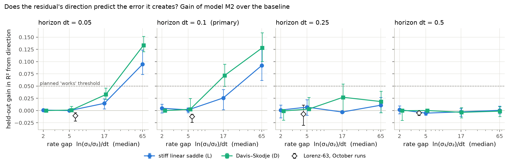
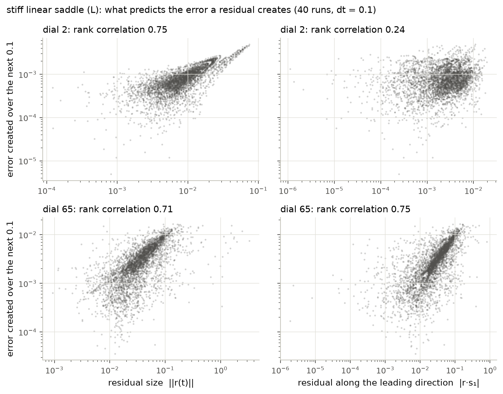
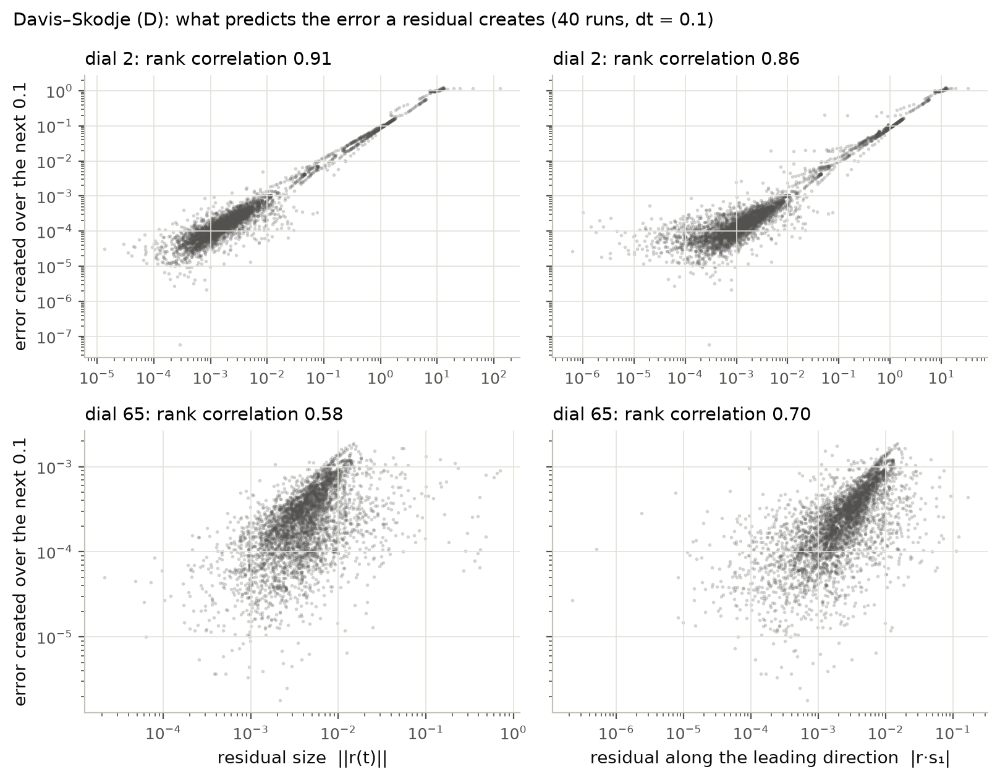

# Dial study: when the direction of a PINN residual predicts its error

*Results of the study planned in [`dial_study_plan.md`](dial_study_plan.md)
(plan committed before any of its PINNs was trained; running record in
[`dial_study_progress.md`](dial_study_progress.md)).*

## The question in plain words

A PINN never satisfies its differential equation exactly. What is left over at
each moment, the **residual** r(t), acts like a small push on the solution. The
dynamics then carry each push forward. Pushes in some directions are stretched
and become large errors; pushes in other directions shrink and disappear.

The original project asked whether this direction effect can be seen in
practice: does knowing the residual's direction, and not only its size,
predict the PINN's later error? For Lorenz-63 the answer was no, on 40 planned
runs and again on 40 fresh runs.

This study asks **when** the answer can be yes. Theory says three things are
needed:

1. **A large stretching gap.** The dynamics must treat directions very
   differently over the time span considered.
2. **Residuals that point in different directions**, so that direction can
   tell cases apart.
3. **A target that the residual actually causes.** Error inherited from
   earlier moments cannot be explained by the residual now.

In the Lorenz PINNs the gap over the useful time span was small. Pointing in
the most-stretched direction instead of the next one changed the outcome by a
median of only 1.8 times at horizon 0.1. The residuals were already pointing
almost entirely along the stretching direction. A residual also keeps its
direction for only about 0.1 time units, so a large gap would be needed at
short horizons.

## What was done

Two families of simple two-dimensional systems were chosen so that the gap can
be turned like a **dial**. Each family was used at four settings, with the
rate difference between its two directions set to 2, 5, 17 and 65:

- **Stiff linear saddle (family L).** One direction grows at rate 1, the
  other shrinks at rate kappa = 1, 4, 16 or 64.
- **Davis–Skodje system (family D).** This is a standard nonlinear slow–fast
  test problem. One direction decays slowly (rate 1), the other quickly
  (rate gamma = 3, 6, 18 or 66). Its directions turn as the state moves.

At horizon 0.1 the median stretching ratio sigma_1/sigma_2 runs from about 1.2
at dial 2 (Lorenz-like) to about 700 at dial 65.

At every setting, 40 standard PINNs were trained: 8 starting points × 5
seeds. The network and loss were the same everywhere. The planned test was then
applied at horizon 0.1:

- **The question asked of each sample.** Does adding the residual's component
  along the leading direction, log |r·s₁|, to a baseline of residual size and
  elapsed time improve the prediction of the error the PINN creates over the
  next 0.1 time units?
- **Fair evaluation.** Each starting point was held out in turn, so every
  prediction is made for a starting point the model was not fitted on.
- **The prediction.** The gain should grow with the dial: negligible at dial 2,
  substantial at dial 65.

## The result in one paragraph

**At Lorenz-like gaps, direction adds nothing. At large gaps it clearly does,
in both families.**
- At dial 2 and 5 the gain is between −0.000 and +0.005 in R².
- At dial 65 the gain is +0.09 (stiff saddle) and +0.13 (Davis–Skodje), with
  intervals well above zero.
- At the top settings the gain improves the prediction for all 8 held-out
  starting points.
- Residuals along random directions give no gain at all.

The October Lorenz runs have a rate gap of about 5.7 at this horizon. They sit
in the region where both families also show no effect, and their gain is
−0.012. So the original negative result is what the dial predicts for Lorenz,
not evidence that direction never matters.

**The verdict under the pre-set rule is "partly supported".** Family L
satisfies every condition. Family D shows the predicted rise most clearly,
but its top setting misses one control condition. The reason is explained
below.

*Each point is one dial setting: 40 PINNs, 8 held-out starting points, and a
95% interval from resampling whole starting points. The open diamond is the
October Lorenz-63 set. The dashed line is the planned "works" threshold of
+0.05.*

## The planned test, setting by setting

The primary horizon is dt = 0.1 and the target is the log of the error created
inside the horizon. The baseline is residual size plus elapsed time (tau,
tau²). The gain is that of model M2, which adds log |r·s₁|.

| setting | dial | median sigma_1/sigma_2 | baseline R² | gain in R² (95% interval) | held-out starts improved | planned verdict |
|---|---:|---:|---:|---|---:|---|
| saddle, kappa = 1 | 2 | 1.22 | 0.49 | +0.005 (−0.005, +0.013) | 5/8 | fails |
| saddle, kappa = 4 | 5 | 1.65 | 0.42 | +0.001 (−0.004, +0.006) | 5/8 | fails |
| saddle, kappa = 16 | 17 | 5.47 | 0.26 | +0.026 (+0.002, +0.043) | 7/8 | inconclusive |
| saddle, kappa = 64 | 65 | 665 | 0.35 | **+0.092 (+0.062, +0.131)** | 8/8 | **works** |
| Davis–Skodje, gamma = 3 | 2 | 1.25 | 0.94 | −0.000 (−0.002, −0.000) | 1/8 | fails |
| Davis–Skodje, gamma = 6 | 5 | 1.71 | 0.95 | +0.003 (+0.002, +0.025) | 8/8 | fails |
| Davis–Skodje, gamma = 18 | 17 | 5.95 | 0.40 | **+0.072 (+0.049, +0.095)** | 8/8 | **works** |
| Davis–Skodje, gamma = 66 | 65 | 746 | 0.28 | **+0.128 (+0.100, +0.159)** | 8/8 | inconclusive (see below) |
| Lorenz-63 (October, reference only) | – | 1.77 | 0.29 | −0.012 (−0.024, −0.007) | 0/8 | – |

**Family verdicts.**
- **Family L is supported.**
  - The largest setting works.
  - The smallest fails.
  - Kendall's tau between dial and gain is 0.67, the minimum allowed. Dial 2
    and dial 5 are in the wrong order, and both gains are below 0.006.
- **Family D is not supported under the rule.**
  - The smallest setting fails, and Kendall's tau is 1.00.
  - But the largest setting is "inconclusive" rather than "works".
- **Overall verdict: partly supported.**

## Why the top Davis–Skodje setting missed the rule

The rule required the gain to beat two controls: random directions and a
time-shuffled s₁. The top setting beats random directions overwhelmingly: the
95th percentile of 20 random-direction gains is 0.0000, against a real gain of
0.128. It does not beat the time shuffle: the shuffled gain is +0.129 against
the real +0.128.

The shuffle could not work there:
- **s₁ does not turn when gamma is large.** The fast direction erases any push
  along y2 within about 1/66 time units. The most-stretched direction s₁ is
  then simply the y1 axis, at every time.
- **Measured turning within a run:** s₁ turns by about 11° at gamma = 3, 8° at
  gamma = 6, 3° at gamma = 18 and **0.0°** at gamma = 66.
- **So the shuffle changes nothing.** Shuffling a constant vector in time
  returns the same vector, and therefore the same gain.

The plan had already declared this control "not applicable" for family L for
exactly this reason. It wrongly assumed that family D's directions would turn
at every setting.

Treating the shuffle as not applicable where s₁ is constant within each run,
as for family L, family D would meet all conditions: dial 17 and dial 65 both
"work". **This reading is post hoc and is reported as such. The verdict of the
plan as written stays "partly supported".**

## What the scatter plots show

**At dial 2, the residual's size is what matters.** Its rank correlation with
the created error is 0.75 for the saddle and 0.91 for Davis–Skodje. Keeping
only the component along s₁ throws information away; for the saddle the rank
correlation falls to 0.24. Both directions create comparable error, so
direction carries no extra information.

**At dial 65 the picture changes.** A residual pointing into the fast-decaying
direction is large but creates almost no error.
- For Davis–Skodje, the rank correlation with residual size drops to 0.58,
  while the component along s₁ reaches 0.70.
- For the saddle, the component along s₁ forms a tight diagonal band.

## Further observations (not part of the decision)

1. **The effect needs the residual to keep its direction.**
   - The gain is largest at dt = 0.05 and 0.1 (up to +0.13).
   - It is small at dt = 0.25 and gone at dt = 0.5, even though the
     stretching ratio there is enormous (up to 10¹⁴).
   - The residual's direction stops persisting at those horizons. Its mean
     signed cosine between t and t + dt is about +0.5 at dt = 0.1, and near
     zero or negative at 0.25 and 0.5.
   - Direction only helps when the gap is large **within the time the
     residual keeps its direction**.
2. **Total future error is mostly not helped.**
   - With the total future error ||e(t+dt)|| as the target (the secondary
     target), the gain at dt = 0.1 is at most +0.017.
   - Error inherited from earlier residuals hides the effect, as in Lorenz.
   - One exception: Davis–Skodje at dt = 0.25, where direction adds +0.11 to
     +0.13 for the total error at gamma = 18 and 66.
3. **The effect is not just the start-up transient.** This check was added
   after seeing family L. Using only samples with t ≥ 0.25, after the fast
   transient has decayed, the gains are:
   - +0.076 at saddle dial 65;
   - +0.078 at Davis–Skodje dial 17;
   - +0.134 at Davis–Skodje dial 65.
4. **Accuracy and the less accurate runs.**
   - All 320 runs finished. 304 of them kept their maximum error within 5% of
     the solution size.
   - Six saddle runs at kappa = 64 reached 5.0–6.6%.
   - Ten Davis–Skodje runs at gamma = 3 and 6 missed the soft initial
     condition in windows 7 and 8, with an initial error of 1.1–3.9.
   - Leaving these 16 runs out (a post-hoc check) changes nothing that
     matters: gamma = 3 gives −0.001, gamma = 6 gives +0.014, and kappa = 64
     gives +0.097.
5. **Model form.** The planned linear-alignment model M1 gives slightly larger
   gains than M2 at the top settings: +0.124 for the saddle and +0.167 for
   Davis–Skodje at dial 65. The oracle propagator features M3 and M4 are
   similar.

## What this means

- **The direction idea is not wrong; it has a threshold.** A residual's
  direction predicts the error it creates when the dynamics treat directions
  very differently over the short time the residual keeps its direction.
  Stiff problems are the natural case: knowing that a residual points into a
  fast-decaying direction tells you it is mostly harmless.
- **Lorenz-63 is below that threshold.** Over the time scale on which a PINN
  residual keeps its direction, its stretching gap is small. That is why the
  original tests were negative, and the dial puts Lorenz exactly where both
  test families also show nothing.
- **Practical consequence.** For stiff systems, the size of a PINN residual
  overstates how much error it causes. A direction-aware measure is more
  informative.

## Limits

- **The directions are oracle quantities**, computed from the reference
  solution. No reference-free predictor has been shown yet.
- **The systems are two-dimensional and simple.** Family L is linear. One
  network design was used, with window length 2.
- **The effects are moderate:** about 0.07–0.17 in held-out R² at the top
  settings.
- **Some checks were added after seeing results.** The late-time check, the
  accurate-runs-only check and the shuffle reading are post hoc and labelled.
- **Phase 9 (a directional training loss) was not run.**

## What would come next

1. **A reference-free version.** In a stiff system the fast and slow
   directions can be estimated from the Jacobian at the PINN's own state.
   Testing that estimate against the oracle s₁, on fresh starting points,
   would turn this into a usable diagnostic.
2. **A larger or chaotic stiff system**, for example a stiff chemical
   mechanism or a model with fast and slow variables, to see whether the
   threshold behaviour holds beyond two dimensions.
3. **A directional loss.** Down-weighting residual components along
   fast-decaying directions during training is now a testable idea, but only
   in stiff settings like these.

## Files

- **Plan and running record:** [`dial_study_plan.md`](dial_study_plan.md) and
  [`dial_study_progress.md`](dial_study_progress.md).
- **Scripts:**
  - `experiments/24_dial_reference.py`: references and directions.
  - `experiments/25_dial_pinn_runs.py`: PINNs.
  - `experiments/26_dial_analysis.py`: the analysis.
- **Results:**
  - `results/dial_study/analysis/metrics.json`: every number above.
  - `results/dial_study/pinn_summary.json`: accuracy of all 320 runs.
  - `results/dial_study/reference/metrics.json`: dial descriptives and checks.
