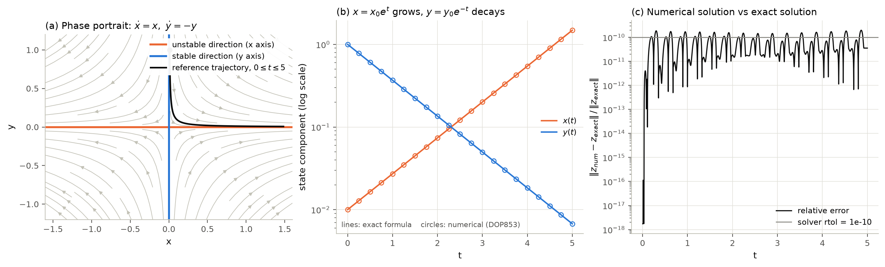
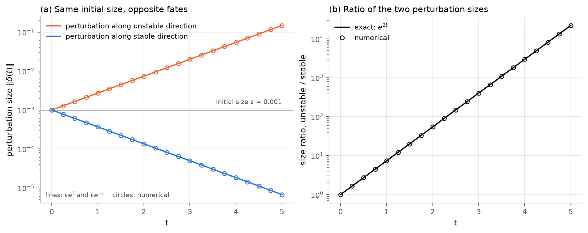
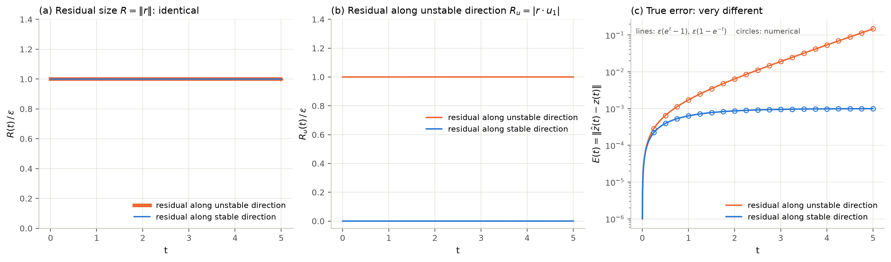
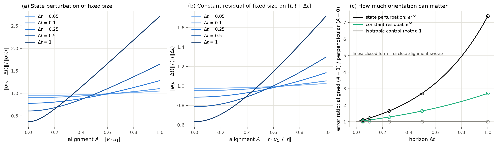
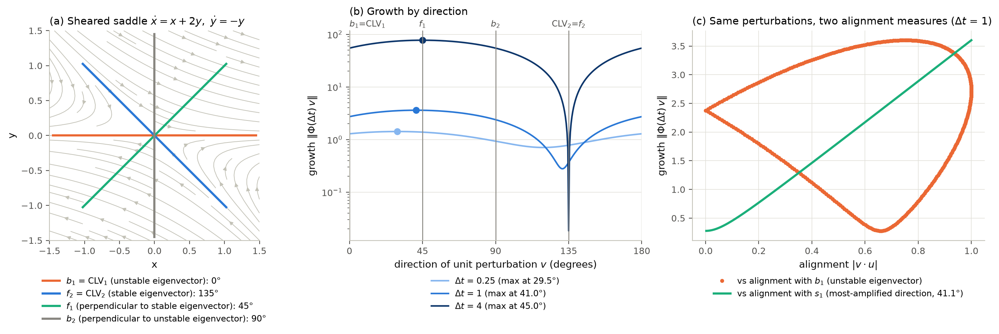

# Phase 0: why the direction of a residual can matter

This note explains what `experiments/01_linear_sanity.py` computes and why it
motivates the research question. Every number below comes from
`results/linear_sanity/metrics.json` (default config, ε = 10⁻³, T = 5).

## 1. The system

$$
\dot x = x,\qquad \dot y = -y
\qquad\Longleftrightarrow\qquad
\dot z = A z,\quad A = \begin{pmatrix}1 & 0\\ 0 & -1\end{pmatrix}.
$$

The exact solution is $x(t) = x_0 e^{t}$, $y(t) = y_0 e^{-t}$. Trajectories slide
in along the $y$ axis and leave along the $x$ axis (Fig. 1a). The $x$ axis is the
**unstable direction** (growth rate $+1$), the $y$ axis the **stable direction**
(rate $-1$). The rates are the eigenvalues of $A$; for this system they are also its
Lyapunov exponents.

The numerical solver (DOP853, rtol 10⁻¹⁰, atol 10⁻¹²) reproduces the exact
solution with maximum relative error 2.0 × 10⁻¹⁰ on $[0, 5]$ (Fig. 1c).



## 2. Errors and residuals obey one equation

**State perturbation.** Change the state by a small vector $\delta$. Because the
system is linear, the difference between the perturbed and the original solution
obeys the same equation, $\dot\delta = A\delta$, so $\delta(t+\tau) = e^{A\tau}\delta(t)$.

**Residual.** An approximate solution $\hat z(t)$, for example a PINN output,
generally does not satisfy the ODE exactly. Its residual is what is left over when
it is substituted into the equation:

$$
r(t) = \frac{d\hat z}{dt} - A\hat z(t).
$$

Subtracting $\dot z = Az$ shows that the error $e = \hat z - z$ satisfies
$\dot e = A e + r(t)$. Solving this linear equation (variation of constants, also
called Duhamel's principle) gives

$$
e(t) = e^{At} e(0) + \int_0^t e^{A(t-s)}\, r(s)\, ds .
$$

How to read the integral: during each short interval $ds$ the residual pushes the
approximate solution off the true one by a small kick $r(s)\,ds$. The dynamics then
carries that kick forward and multiplies it by $e^{A(t-s)}$: a kick along $x$ is
amplified by $e^{t-s}$, a kick along $y$ is shrunk by $e^{-(t-s)}$. The error at time
$t$ is the sum of all past kicks, each amplified or shrunk according to its
direction and its age. **A residual acts like a continuous stream of small state
perturbations.**

The formula is exact here because the system is linear. For Lorenz-63 the same
statement holds to first order in the error, with $e^{A(t-s)}$ replaced by the
tangent propagator $\Phi(t, s)$ along the true trajectory (Phase 3). The formula
does not care how $\hat z$ was produced, so it applies to a PINN.

## 3. Results

### Equal-size state perturbations (Fig. 2)

Perturbations of size ε = 10⁻³ along $x$ and along $y$ end, at $T = 5$, with sizes
$\varepsilon e^{5} = 0.148$ and $\varepsilon e^{-5} = 6.7\times10^{-6}$. Their ratio is
$e^{2T} \approx 22\,026$; the numerical solution agrees to a relative error of 4 × 10⁻¹⁰.



### Equal-size residuals (Fig. 3)

Two approximate solutions start at the exact initial state but violate the ODE by
a constant vector of size ε, one along $x$ and one along $y$. Measuring their
residuals by finite differences (the way a PINN measures them by automatic
differentiation) gives $R(t)/\varepsilon \in [0.9995, 1.0003]$ for both: the
residual size cannot tell them apart. The component along the unstable direction
can: $R_u = \varepsilon$ for the first and $R_u = 0$ for the second. Their true errors are

$$
E_{\text{along }x}(t) = \varepsilon\,(e^{t} - 1),
\qquad
E_{\text{along }y}(t) = \varepsilon\,(1 - e^{-t}),
$$

so the first grows without bound (0.147 at $T = 5$) while the second levels off at ε.
The ratio is exactly $e^{t}$, i.e. 148 at $T = 5$.



### Orientation at fixed size, and the role of the horizon (Fig. 4)

Rotate a residual of fixed size through every direction $(\cos\theta, \sin\theta)$
and define its alignment with the unstable direction $u_1 = (1, 0)$,
$A = |r\cdot u_1| / \lVert r\rVert = |\cos\theta|$. After a horizon $\Delta t$:

* state perturbation: $\lVert\delta(t+\Delta t)\rVert / \lVert\delta(t)\rVert = \sqrt{A^2 e^{2\Delta t} + (1-A^2)\,e^{-2\Delta t}}$
* constant residual on $[t, t+\Delta t]$, starting from zero error:
  $\lVert e(t+\Delta t)\rVert = \lVert r\rVert\sqrt{A^2 (e^{\Delta t}-1)^2 + (1-A^2)(1-e^{-\Delta t})^2}$

At fixed size, both increase strictly with $A$. How much they increase depends on
the horizon. Ratio of the error for $A = 1$ to the error for $A = 0$:

| $\Delta t$ | state perturbation, $e^{2\Delta t}$ | constant residual, $e^{\Delta t}$ | isotropic control |
|---:|---:|---:|---:|
| 0.05 | 1.105 | 1.051 | 1 |
| 0.1  | 1.221 | 1.105 | 1 |
| 0.25 | 1.649 | 1.284 | 1 |
| 0.5  | 2.718 | 1.649 | 1 |
| 1.0  | 7.389 | 2.718 | 1 |

For short horizons $e(t+\Delta t) \approx r\,\Delta t$ whatever the direction: the
dynamics has not yet had time to act. Orientation matters only once the difference
of growth rates times the horizon, here $(\lambda_u - \lambda_s)\Delta t = 2\Delta t$,
is no longer small. In this toy, at $\Delta t = 0.05$ orientation changes the
residual-induced error by only 5 %.

**Negative control.** For the isotropic system $\dot z = z$ every direction grows at
the same rate and the ratio is exactly 1 at every horizon: orientation carries no
information. Any orientation-based error indicator must show no advantage on such a
system. This is one concrete way in which the hypothesis can fail.



## 4. Caveat: which "unstable direction"? (Fig. 5)

In the saddle, $A$ is symmetric, the unstable and stable directions are
perpendicular, and every reasonable definition of "the unstable direction" gives
the $x$ axis. Lorenz-63 is different: its Jacobian is not symmetric (not even
normal), and its expanding and contracting directions are generally not
perpendicular. The smallest example of this is the sheared saddle

$$
\dot x = x + c\,y,\qquad \dot y = -y,
\qquad A = \begin{pmatrix}1 & c\\ 0 & -1\end{pmatrix},\qquad c = 2,
$$

with exact solution $x(t) = x_0 e^{t} + c\,y_0\sinh t$, $y(t) = y_0 e^{-t}$. The
eigenvalues are still $+1$ and $-1$, but the eigenvectors are $(1, 0)$ at 0° and
$(-c, 2)/\sqrt{c^2+4}$ at 135°, which are not perpendicular. Several standard
objects now give different answers:

| name | meaning | how it is computed | angle for $c = 2$ |
|---|---|---|---|
| CLV₁, CLV₂ (covariant Lyapunov vectors) | directions the dynamics maps onto themselves; here the eigenvectors of $A$ | here: eigenvectors; in general: forward and backward information combined | 0°, 135° |
| $b_1, b_2$ (backward or Gram–Schmidt Lyapunov vectors) | the orthonormal basis that "propagate forward, re-orthonormalise with QR" converges to; $b_1$ is the direction past perturbations have lined up with | QR method; planned for Phase 3 | 0°, 90° |
| $f_1, f_2$ (forward Lyapunov vectors) | right singular vectors of $\Phi(\tau)$ for long $\tau$; $f_1$ is the direction that will grow the most | needs the future of the trajectory | 45°, 135° |
| $s_1(\Delta t)$ (finite-time singular vector) | the perturbation that grows the most over exactly $\Delta t$ | SVD of $\Phi(t+\Delta t, t)$ | 29.4° ($\Delta t$ = 0.25), 41.1° (1), 45.0° (4); tends to 22.5° as $\Delta t \to 0$ |

In 2-D the relations are $b_1 = \text{CLV}_1$, $f_2 = \text{CLV}_2$, $b_2 \perp b_1$ and
$f_1 \perp f_2$. The experiment checks these closed forms against repeated QR and
against the SVD of $\Phi(20)$.

What Fig. 5 shows:

* A unit perturbation along $b_2$, perpendicular to the unstable eigenvector, has
  alignment 0 if one projects on $u_1 = b_1$. Yet it eventually grows like
  $(c/2)\,e^{t}$: by a factor 54.58 at $\Delta t = 4$, as much as along $b_1$ itself
  (54.60). With $u_1 = b_1$, the "transverse" residual $R_\perp$ is not harmless.
* Along $f_1$ (45°) the growth is $\sqrt{1 + c^2/4}\;e^{t}$: 77.2 at $\Delta t = 4$, more
  than along the unstable eigenvector.
* Only along the stable eigenvector CLV₂ does a perturbation shrink, by $e^{-\Delta t}$.
* Panel (c), $\Delta t = 1$: plotted against alignment with $b_1$, growth traces a
  loop, so one alignment value corresponds to two different growths. Plotted
  against alignment with $s_1(\Delta t)$ it is a single increasing curve. In 2-D this
  is exact: $\lVert\Phi v\rVert^2 = \sigma_2^2 + (\sigma_1^2 - \sigma_2^2)(v\cdot s_1)^2$.



**Consequence for the project.** The QR vector $b_1(t)$ answers "along which direction
have errors been growing?". A finite-time singular vector $s_1(t;\Delta t)$ answers
"along which direction will a new error grow most over the next $\Delta t$?". The
research question is about future error, which points to the second; $b_1$ is the
first-planned choice and is cheaper. The proposal for Phase 3 is to compute both
along the reference trajectory and to compare them as separate, pre-declared
predictors in Phase 6.

## 5. What this toy does not show

* **Linearity.** All formulas above are exact here. For Lorenz they hold only while
  the error is small enough for the linearisation to be accurate, and PINN errors
  on Lorenz may not be small.
* **Fixed directions.** In Lorenz the expanding and contracting directions rotate
  along the trajectory.
* **Constant residuals.** PINN residuals change sign and direction over time, so
  successive kicks in the Duhamel integral can cancel. The residual at a single time
  is then a weak proxy for the error it causes, whatever its direction.
* **Inherited error.** The future error $E_\Delta(t) = \lVert\hat z(t+\Delta t) - z(t+\Delta t)\rVert$
  also contains error made before $t$:
  $e(t+\Delta t) = \Phi(t+\Delta t, t)\,e(t) + \int_t^{t+\Delta t}\Phi(t+\Delta t, s)\,r(s)\,ds$.
  Only the second term depends on the residual near $t$. Phase 6 should state in
  advance whether the target is the total future error, the window contribution,
  or both.
* **Rates.** The toy has rates $\pm 1$. Lorenz-63 has time-averaged Lyapunov
  exponents of about $+0.91$, $0$ and $-14.57$, and local stretching rates that vary
  strongly along the attractor. Section 3 suggests that orientation can only carry
  information at horizons where rate differences times $\Delta t$ are not small.

## Reproduce

```bash
python experiments/01_linear_sanity.py   # figures, CSV data, metrics.json in results/linear_sanity/
python -m pytest                          # unit tests
```
