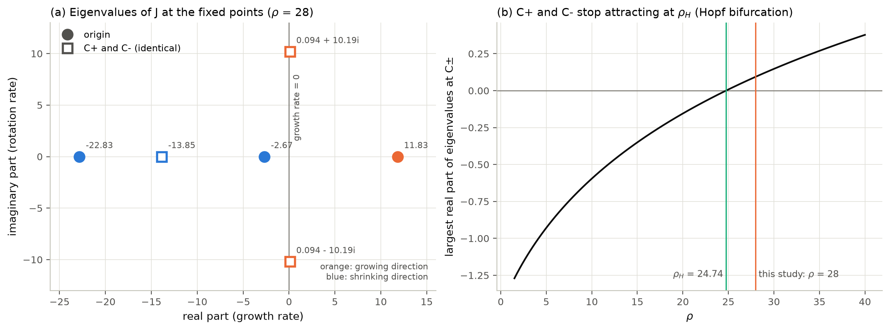

# Phase 1: the Lorenz-63 equations and their Jacobian

This note explains `src/systems/lorenz63.py` and `experiments/02_lorenz_jacobian.py`.
Numbers come from `results/lorenz_jacobian/metrics.json` (classical parameters).

## 1. The equations

$$
\dot x = \sigma (y - x),\qquad
\dot y = x(\rho - z) - y,\qquad
\dot z = x y - \beta z,
\qquad \sigma = 10,\ \rho = 28,\ \beta = 8/3 .
$$

Lorenz (1963) derived these as a drastically simplified model of convection: $x$
measures the strength of the convective motion, while $y$ and $z$ measure
temperature differences. The only nonlinear terms are the two products $-xz$ and
$xy$. In code: `lorenz_rhs(t, state, params)`. The system is autonomous (time does
not appear on the right-hand side), so `t` is ignored; it is there only because
SciPy's `solve_ivp` expects that signature.

## 2. What the Jacobian means here

The Jacobian collects how each right-hand side changes when one state variable
changes slightly. Row $i$ holds the partial derivatives of equation $i$:

$$
J(x, y, z) =
\begin{pmatrix}
-\sigma & \sigma & 0\\
\rho - z & -1 & -x\\
y & x & -\beta
\end{pmatrix}.
$$

For example, row 2 comes from $\dot y = x(\rho - z) - y$: its derivatives with
respect to $x$, $y$, $z$ are $\rho - z$, $-1$ and $-x$.

**Why it matters for this project.** If two solutions differ by a small vector
$\delta$, their velocities differ by approximately $J\delta$. So the difference
obeys the *tangent equation*

$$
\dot\delta = J(x(t))\,\delta .
$$

In Phase 0 the matrix was a constant $A$, and perturbations evolved by
$e^{At}$. Here $J$ changes as the trajectory moves, so the expanding and
contracting directions rotate along the way and there is no closed-form
propagator. Phase 3 integrates the tangent equation numerically. The error
equation of a PINN, $\dot e \approx J(x(t))\,e + r(t)$, uses the same matrix.

Three properties worth knowing:

* **$J$ is not symmetric, not even normal** ($JJ^\top \neq J^\top J$). So the warning
  from the sheared saddle in Phase 0 applies: expanding and contracting directions
  are generally not perpendicular, and the QR vector $b_1$ can differ from the
  finite-time singular vector $s_1$. Phase 3 will compute both.
* **The trace is constant:** $\operatorname{tr} J = -(\sigma + 1 + \beta) = -41/3 \approx -13.67$
  at every state. The trace is the rate at which the flow changes small volumes,
  so any small blob of initial conditions shrinks in volume by a factor
  $e^{-13.67} \approx 1.2\times10^{-6}$ per time unit. This is why the attractor is a
  thin set with zero volume. The three Lyapunov exponents must add up to this
  number, which gives a free check for Phase 3 (about $0.91 + 0 - 14.57$).
* **Symmetry:** $(x, y, z) \to (-x, -y, z)$ maps solutions to solutions, which is why
  the attractor's two wings are mirror images.

## 3. Fixed points: where the Jacobian tells the whole local story

Setting all three right-hand sides to zero gives $y = x$, $x^2 = \beta z$ and
$x(\rho - 1 - z) = 0$. So the fixed points are the origin and, for $\rho > 1,$

$$
C_\pm = \left(\pm\sqrt{\beta(\rho-1)},\ \pm\sqrt{\beta(\rho-1)},\ \rho - 1\right) = (\pm 8.485,\ \pm 8.485,\ 27).
$$

Near a fixed point, $J$ evaluated there plays the role of $A$ in Phase 0. Its
eigenvalues give growth rates (real part) and rotation rates (imaginary part):

| fixed point | eigenvalues of $J$ | meaning |
|---|---|---|
| origin | $+11.83,\ -2.67,\ -22.83$ | a 3-D version of the Phase 0 saddle: one expanding direction, two contracting ones |
| $C_\pm$ | $-13.85,\ 0.094 \pm 10.19i$ | one strongly contracting direction; in the other two, a slow outward spiral: the radius grows about 10 % per time unit while circling about 1.6 times per time unit |

These agree with formulas that do not use the code's Jacobian (origin: quadratic
formula on a 2 × 2 block; $C_\pm$: roots of
$\lambda^3 + (\sigma+\beta+1)\lambda^2 + \beta(\sigma+\rho)\lambda + 2\sigma\beta(\rho-1)$) to
better than $10^{-10}$.

All three fixed points are unstable at $\rho = 28$. $C_\pm$ lose their stability at
$\rho_H = \sigma(\sigma+\beta+3)/(\sigma-\beta-1) \approx 24.74$, a Hopf bifurcation
(Fig. 1b; the experiment finds the crossing numerically at 24.736842, equal to the
formula). With no stable resting point, trajectories keep moving and switch
irregularly between the two wings around $C_+$ and $C_-$. Unstable fixed points are
necessary for this behaviour but do not prove chaos by themselves; the positive
Lyapunov exponent computed in Phase 3 will.



**Caution.** Away from fixed points, the eigenvalues of $J(x)$ are *not* the growth
rates of perturbations, because $J$ keeps changing while a perturbation evolves.
The instantaneous growth rate of a perturbation along a unit vector $v$ is
$v^\top S v$ with $S = (J + J^\top)/2$, the symmetric part of $J$. Lyapunov exponents
are long-time averages. Both appear in Phase 3.

## 4. How the Jacobian was verified

The rule "do not proceed if the Jacobian check fails" is a function,
`verify_lorenz_jacobian`, which later phases call before they use the Jacobian.

It checks the three fixed points plus 1000 random states in the box
$x, y \in [-30, 30]$, $z \in [-5, 60]$. The box is larger than the attractor on
purpose: PINN predictions can leave the attractor, and the formula must hold
everywhere. Two independent numerical Jacobians are compared with the formula:

* **Complex step:** column $j$ is $\operatorname{Im} f(x + i h e_j)/h$ with $h = 10^{-30}$.
  There is no subtraction, so no cancellation, and the result is exact up to
  rounding. Largest relative error: $1.3\times10^{-16}$ (tolerance $10^{-12}$).
* **Central differences:** $(f(x + h e_j) - f(x - h e_j))/(2h)$. Normally this has a
  truncation error proportional to $h^2$. Each Lorenz equation is affine in each
  variable separately (products $xz$ and $xy$, never $x^2$), so along a coordinate
  direction the formula is exact apart from rounding. Largest relative error:
  $2.1\times10^{-10}$ (tolerance $10^{-7}$).
* **Control: can the check fail?** The same check applied to a Jacobian with one
  sign flipped ($+x$ instead of $-x$ in row 2) gives relative error 1.3 and is
  rejected. A Jacobian that ignores the parameter values is also rejected (unit
  test with $\sigma = 16$, $\rho = 45.92$, $\beta = 4$).

Further unit tests: hand-computed values; the exact identity
$f(x+d) - f(x) - J(x)d = f(d) - J(0)d$, which holds because $f$ is quadratic and
needs no step size at all; the constant trace; the symmetry; the fixed-point
eigenvalues; the Hopf threshold; and the numerical-Jacobian helpers themselves,
tested on a function unrelated to Lorenz.

## 5. Decision recorded, and design questions for Phase 2

* **Decision:** Phase 3 computes both the backward (QR) vector $b_1(t)$ and the
  finite-time singular vector $s_1(t;\Delta t)$, and Phase 6 compares them as
  separate predictors.
* **$b_1$ needs a past.** The QR iteration only converges after a spin-up: its error
  decays roughly like $e^{-(\lambda_1-\lambda_2)t} \approx e^{-0.9t}$, so about 20 time
  units for $10^{-8}$. Integrating Lorenz backward in time is not an option (the
  contracting rate $-14.6$ becomes an expanding rate $+14.6$). Proposal: a
  configurable seed state is integrated forward for a spin-up time; its end
  point becomes $x(0)$, the PINN's initial condition, and the spin-up segment
  supplies $b_1$'s past.
* **$s_1$ and $E_\Delta$ need a future.** The reference trajectory must extend $\Delta t_{\max}$
  beyond the end of the PINN's time window.

## Reproduce

```bash
python experiments/02_lorenz_jacobian.py   # metrics.json, figure, CSV in results/lorenz_jacobian/
python -m pytest
```
