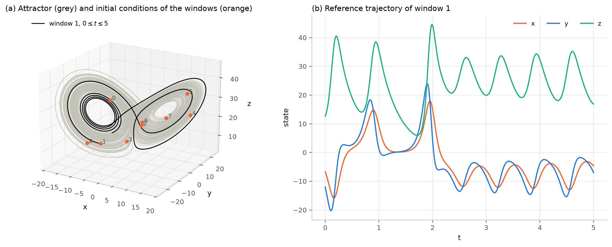
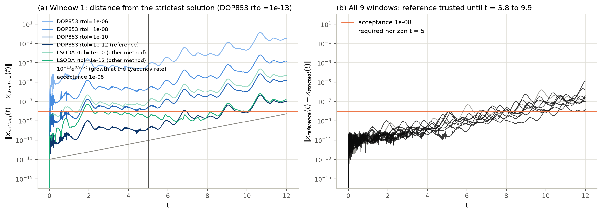

# Phase 2: reference trajectories and how long they can be trusted

Code: `src/solvers/lorenz_reference.py`, `experiments/03_lorenz_reference.py`.
Numbers: `results/lorenz_reference/metrics.json`.

## Design

* **Initial conditions with a past.** A long run starts at $(1, 1, 1)$ and its first
  100 time units are discarded, so that everything afterwards lies on the
  attractor. Window $k$ ($k = 0, \dots, 8$) starts at time $t_k = 130 + 20k$ of the
  long run: its initial condition $x_0^{(k)}$ is the long run's state there, and the
  30 time units before $t_k$ are the window's past. The backward Lyapunov vector
  $b_1$ (Phase 3) depends on that past, and Lorenz cannot be integrated backward in
  time (the contracting rate $-14.6$ would become an expanding rate $+14.6$).
  Windows are 20 time units (about 18 Lyapunov times) apart, so they behave like
  independent initial conditions.
* **Roles.** Window 0 is a pilot: it is used only to choose PINN settings, never in
  the analysis. Windows 1–8 are analysis windows.
* **Reference.** For each window, a fresh DOP853 integration from $x_0^{(k)}$ with
  rtol $10^{-12}$, atol $10^{-14}$, sampled every 0.002 time units on $[0, 12]$, with
  dense output. Starting fresh means that only errors made inside the window
  matter.

## Tolerance study

Each window is re-solved with DOP853 at rtol $10^{-6}, 10^{-8}, 10^{-10}, 10^{-12}$
and with LSODA (a multistep method, a different family) at rtol $10^{-10}$ and
$10^{-12}$, and every solution is compared with DOP853 at rtol $10^{-13}$, which stands
in for the exact solution.

* The DOP853 distances shrink by roughly two orders of magnitude per two orders of
  rtol, and LSODA approaches the same solution as its tolerance tightens. Two
  unrelated methods converging to one answer is the evidence that the answer is
  right.
* All distances grow at roughly the Lyapunov rate $e^{0.906t}$ (Fig. 2a): any
  numerical error, however small, is amplified by the chaos. A reference is
  therefore only meaningful for a limited time.
* The reference stays within $10^{-8}$ of the strictest solution until
  $t = 5.8$ to $9.9$, depending on the window (Fig. 2b). Every PINN window in this
  project lies inside $[0, 5]$, where the reference error is below $10^{-8}$,
  thousands of times smaller than any PINN error analysed later.

**A change made after the first run.** The first version required LSODA at rtol
$10^{-12}$ to stay within $10^{-8}$ of the strictest solution as well. It did not
($1.2\times10^{-8}$ to $3.5\times10^{-7}$ at $t = 5$): LSODA's own error at a given rtol
is larger than DOP853's. The cross-check was therefore re-specified as what it is
meant to show: LSODA's distance must shrink as its tolerance tightens, and stay
within $10^{-6}$ up to $t = 5$. Both conditions hold in all nine windows. The
acceptance for the reference itself ($10^{-8}$) was not changed.





## Reproduce

```bash
python experiments/03_lorenz_reference.py
```

The script writes `data/window_<k>.npz` (reference states, the past, the
deviations), which later phases read; it exits with status 1 if any window
fails its checks.
