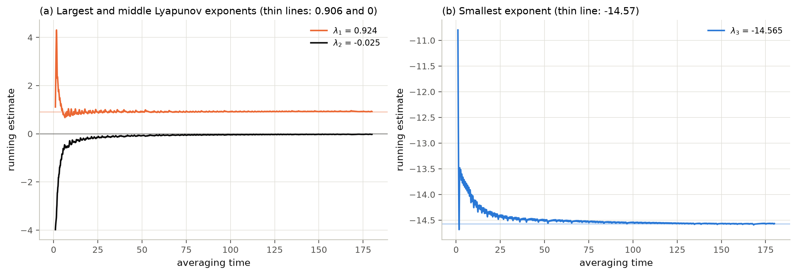
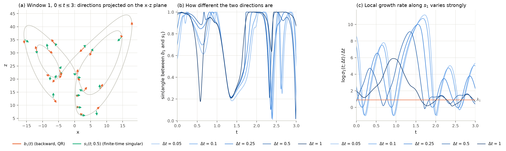

# Phase 3: tangent dynamics, Lyapunov exponents, and two expanding directions

Code: `src/dynamics/tangent_dynamics.py`, `src/dynamics/lyapunov.py`,
`experiments/04_lorenz_lyapunov.py`. Numbers: `results/lorenz_lyapunov/metrics.json`.

## What is computed

**Tangent propagators.** A small perturbation $\delta$ of the reference trajectory
evolves by $\dot\delta = J(x(t))\,\delta$, so $\delta(t) = \Phi(t, s)\,\delta(s)$ with
$\dot\Phi = J(x(t))\Phi$, $\Phi(s, s) = I$. On a uniform grid ($h = 0.002$ inside a
window, $0.005$ on its past) every step propagator $\Phi(t_{i+1}, t_i)$ is
integrated with DOP853, evaluating $J$ on the reference's dense output. The
propagator over $\Delta t$ is a product of step propagators. It is never obtained
by inverting $\Phi(t, 0)$: that matrix's condition number grows like $e^{15.5t}$.

**Backward Lyapunov vectors $b_i(t)$ and exponents (QR method).** An orthonormal
basis is propagated one step at a time and re-orthonormalised by a QR
decomposition, $\Phi(t_{i+1}, t_i)\,Q_i = Q_{i+1}R_i$. The columns of $Q_i$ are the
backward (Gram–Schmidt) Lyapunov vectors at $t_i$. The time averages of
$\log R_i[k,k]$ are the Lyapunov exponents. The iteration starts 30 time units
before each window (Phase 2), so $b_1$ has converged by $t = 0$: starting from two
different bases gives the same $b_1$ throughout every window, to rounding error.
$b_1(t)$ is the direction into which perturbations made in the *past* have turned.

**Finite-time singular vectors $s_i(t;\Delta t)$.** The right singular vectors of
$\Phi(t+\Delta t, t)$. $s_1$ is the unit perturbation at time $t$ that grows the most
over the *next* $\Delta t$, by the factor $\sigma_1(t;\Delta t)$; $s_3$ is the one that
grows least. These are computed for each prediction horizon
$\Delta t \in \{0.05, 0.1, 0.25, 0.5, 1\}$.

Neither is a covariant Lyapunov vector, except that the converged $b_1$ coincides
with the first covariant vector.

## Results

* **Exponents** over 180 time units of the attractor: $0.924$, $-0.025$, $-14.566$
  (commonly quoted: $0.906$, $0$, $-14.572$). Finite averaging time explains the
  difference; the running averages are still settling (Fig. 1). Their sum equals
  the constant trace $-(\sigma+1+\beta) = -13.6667$ to $10^{-6}$, as it must.
* **Propagators are correct:** applied to a perturbation of size $10^{-6}$, they
  reproduce the difference of two nonlinear solutions to a relative error below
  $10^{-4}$ (the expected second-order effect) at every point tested.
* **The two expanding directions differ a lot.** Across the nine windows, the
  median of $\sin\angle(b_1, s_1)$ is 0.68–0.84 at $\Delta t = 0.05$ and 0.81–0.96 at
  $\Delta t = 1$, i.e. typically 50°–75° apart (Fig. 2b). This is the situation of
  the sheared saddle in Phase 0, and it is why both are carried into the main
  analysis. For predicting error growth over a horizon $\Delta t$, $s_1(t;\Delta t)$ is
  the direction singled out by the mathematics, since it maximises the
  amplification over exactly that horizon.
* **Local growth is very uneven.** The finite-time growth rate
  $\log\sigma_1(t;\Delta t)/\Delta t$ swings between about $-1$ and $11$ per time unit
  for short horizons, compared with the average $\lambda_1 \approx 0.9$ (Fig. 2c). Over
  short horizons, orientation could therefore matter much more at some times
  than the average exponent suggests (the Phase 0 argument with a time-varying
  rate gap).





## Reproduce

```bash
python experiments/03_lorenz_reference.py   # if not run yet
python experiments/04_lorenz_lyapunov.py    # about 3 minutes
```

It writes `data/lyapunov_window_<k>.npz` (step propagators, $Q$, singular values
and vectors per horizon, flow direction) for the analysis phases.
