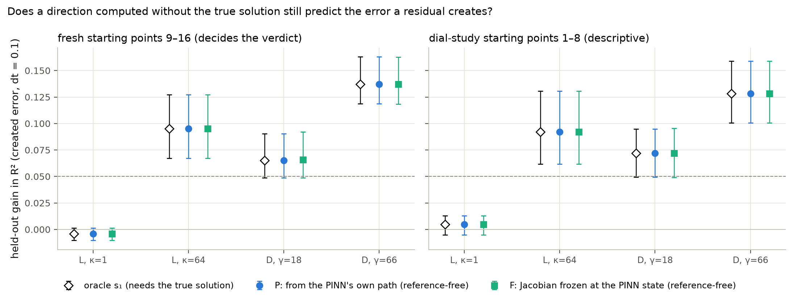

# Reference-free directions: results

*This follows the plan in [`reference_free_plan.md`](reference_free_plan.md).
The plan was committed before any reference-free direction was computed and
before the fresh-window PINNs were trained. The running record is
[`reference_free_progress.md`](reference_free_progress.md).*

## The question in plain words

The dial study showed that a residual's direction predicts the error it
creates when the stretching gap is large. But it used directions computed from
the **true** solution, which a real user does not have.

Here the same directions are computed from the PINN alone. The tangent
equation is integrated along the PINN's own predicted path; this estimate is
called **P**. A cruder estimate freezes the Jacobian at the PINN's current
state; it is called **F**. Both need only the equations and the trained
network. The test was run on 8 fresh starting points per setting (160 new
PINNs) that no earlier analysis had seen.

## Verdict under the planned rule: supported

| setting (fresh windows 9–16) | oracle gain (95% interval) | P gain (95% interval) | F gain | P recovers of the oracle | held-out starts improved |
|---|---|---|---:|---:|---:|
| saddle, kappa = 1 (low-gap control) | −0.004 (−0.010, +0.001) | −0.004 (−0.010, +0.001) | −0.004 | – | 5/8 |
| saddle, kappa = 64 | +0.095 (+0.067, +0.127) | +0.095 (+0.067, +0.127) | +0.095 | 100% | 8/8 |
| Davis–Skodje, gamma = 18 | +0.065 (+0.049, +0.090) | +0.065 (+0.049, +0.091) | +0.066 | 100% | 8/8 |
| Davis–Skodje, gamma = 66 | +0.137 (+0.119, +0.163) | +0.137 (+0.119, +0.163) | +0.137 | 100% | 8/8 |

Gains are held-out R² for the created error at horizon 0.1, over the baseline
of residual size and time. The random-direction 95th percentiles are at most
0.0002 everywhere.

- **(A) The dial finding replicates on fresh starting points.** The oracle
  direction "works" at all three high-gap settings, and the low-gap control
  shows nothing.
- **(B) Reference-free direction: supported.** At both Davis–Skodje settings
  P meets every condition and recovers 100% of the oracle gain. The paired
  difference is 0.0000. The secondary estimate F also passes.

## Why the match is so close, and why that is partly expected

The reference-free directions point almost exactly where the oracle does. The
median angle between them at horizon 0.1, on the fresh windows:

| setting | P vs oracle | F vs oracle |
|---|---:|---:|
| Davis–Skodje, gamma = 18 | 0.0003° | 0.10° |
| Davis–Skodje, gamma = 66 | 0.000006° | 0.0012° |

For the linear saddle the Jacobian is constant, so both estimates are exact by
construction.

Two things make this easy:
1. **The PINNs are accurate.** Their median errors are about 1e-4 to 1e-3, so
   the Jacobian along the PINN path is almost the true one.
2. **The leading direction barely depends on the state.** At large gamma it is
   simply the y1 axis.

The test therefore shows that reference-free directions work **in this
setting**. It is not a demanding test of how robust they are.

**Lorenz-63 is the harder case** (descriptive, October runs). There the
directions turn quickly along the attractor, and some PINNs are inaccurate:
- **P (the PINN's own path)** is within 0.8° of the oracle at the median, but
  18.6° at the 90th percentile.
- **F (the frozen Jacobian)** is much worse: 6.5° at the median and 45.7° at
  the 90th percentile.
- **No gain either way.** In Lorenz the direction carries no extra information
  in any version (gains −0.012 for the oracle and −0.003 for P), as before.

## What this means

For stiff systems like these, there is a **practical, reference-free
directional indicator**:
1. compute the leading stretching direction from the tangent propagator along
   the PINN's own path;
2. project the residual onto it.

It predicts the error the PINN creates over the next short stretch better than
the residual's size does. It gains +0.07 to +0.14 in held-out R² on unseen
starting points, the same as the oracle.

## Limits

- **The systems are small and the test is easy.** They are two-dimensional.
  The reference-free directions are nearly exact because the PINNs are
  accurate and the directions depend little on the state.
- **The target still needs the reference.** It is the error the PINN creates,
  so it can only be evaluated with the true solution. The indicator predicts
  that error; it is not an error estimate with a guarantee.
- **It has not been tested where PINNs are inaccurate in a stiff system.** The
  directions there would be both important and hard to estimate, as in a stiff
  chaotic system or a larger stiff chemical model.

## Files

- **Analysis:** `experiments/27_reference_free_analysis.py`, output in
  `results/reference_free/analysis/`.
- **Fresh runs:** `results/reference_free/<setting>/runs/`.
- **Fresh references:** `results/reference_free/reference/`.
- **Helpers:** `pinn_path_step_propagators` and `frozen_jacobian_propagators`
  in `src/dynamics/tangent_dynamics.py`.
