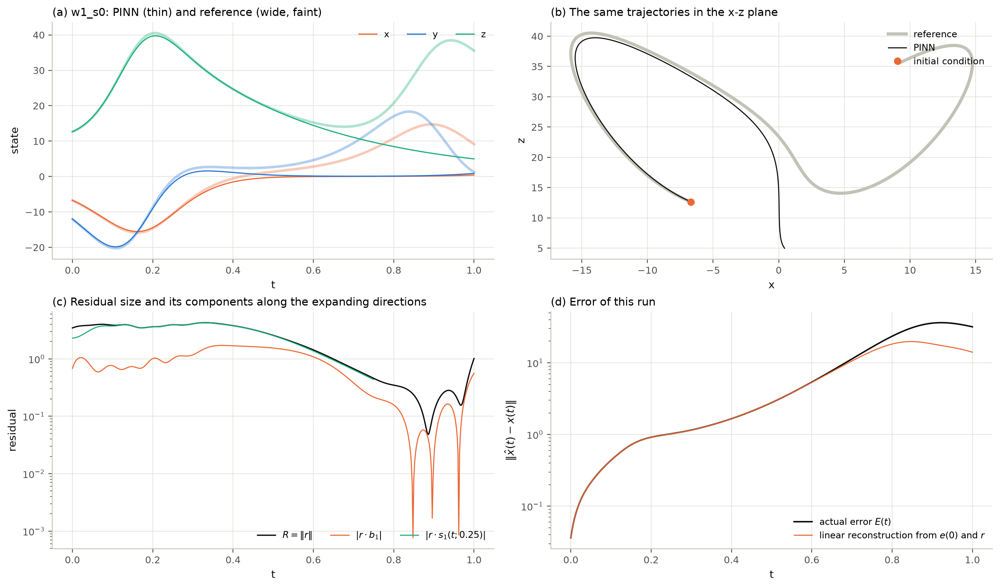
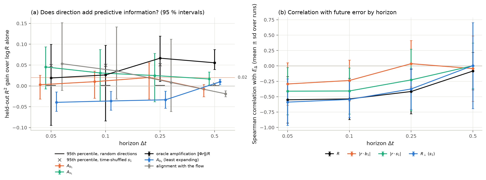
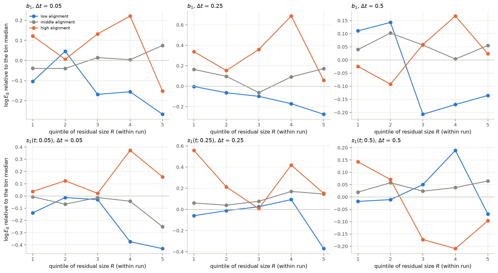
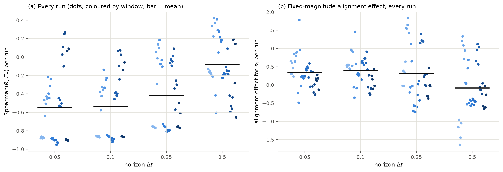
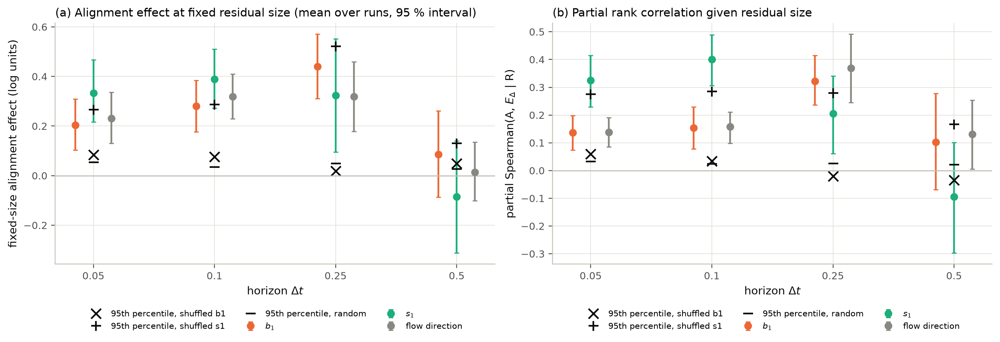

# Results: does residual direction predict future PINN error?

**Short answer: no, not in the sense tested here.** For standard PINNs on
Lorenz-63, the component of the residual along a locally expanding direction did
not predict future trajectory error better than the residual's size, under the
decision rule fixed before the main runs (`docs/analysis_plan.md`). This held for
both candidate directions, the backward Lyapunov vector $b_1$ and the finite-time
singular vector $s_1$. As planned, the directional training loss (Phase 9) was
therefore not attempted.

The rest of this document gives the evidence, what did show an effect, and the
limits of the conclusion.

## 1. What was run

* **System:** Lorenz-63, $\sigma = 10$, $\rho = 28$, $\beta = 8/3$.
* **Initial conditions:** 8 analysis windows taken from a long run on the
  attractor (Phase 2), each with a 30-unit past so that $b_1$ is converged.
  A 9th window was used only to choose PINN settings.
* **Reference:** DOP853 at rtol $10^{-12}$, within $10^{-8}$ of a stricter solution
  over every PINN window.
* **PINNs:** 4 × 64 tanh network, standard loss
  $\frac1N\sum\lVert r\rVert^2 + 100\,\lVert\hat x(0) - x_0\rVert^2$, Adam (20 000 iterations), time
  curriculum, float32, window $[0, 1]$; 5 seeds per window, 40 runs, none
  excluded.
* **Why the window is only one time unit long.** Plain training collapsed onto the
  invariant $z$-axis solution for every window of length 2 or more, and with a
  time curriculum the standard PINN still followed the trajectory only over
  length 1, about one Lyapunov time (`docs/phase4_pinn.md`). This is a known
  weakness of PINNs on chaotic systems, and it limits what can be tested (see
  section 6).

Across the 40 runs, the median error ranges from 0.003 to 25. Windows 2, 6 and 7
(and some seeds of windows 3 and 8) are accurate; windows 1, 4 and 5 drift away
from the reference within the window, reaching errors comparable to the
attractor's size. The linear (Duhamel) reconstruction
$e(t) \approx \Phi(t,0)e(0) + \int_0^t\Phi(t,s)r(s)\,ds$ matches the actual errors with a
median relative mismatch of 6 %, and on average only 3 % of the error comes from
the initial-condition error. So the errors really are produced by the residual
being carried forward by the dynamics, which is the mechanism the hypothesis
relies on (Fig. 1d).

## 2. The planned test

Target: $\log E_\Delta(t) = \log\lVert\hat x(t+\Delta t) - x(t+\Delta t)\rVert$. Baseline M0: $\log E_\Delta$ from
$\log R$ alone. M1: adds the alignment $A_u = |r\cdot u| / \lVert r\rVert$. Leave-one-window-out
prediction, 95 % intervals from a bootstrap over runs. The horizon
$\Delta t = 1$ has no usable data in a window of length 1.

| $\Delta t$ | $R^2$ of M0 | gain with $A_{b_1}$ | gain with $A_{s_1}$ | gain with $\lVert\Phi r\rVert/R$ (oracle) |
|---:|---:|---|---|---|
| 0.05 | −0.20 | +0.003 [−0.031, +0.026] | +0.046 [−0.007, +0.094] | +0.019 [−0.095, +0.100] |
| 0.1  | −0.13 | +0.010 [−0.030, +0.036] | +0.031 [−0.036, +0.087] | +0.026 [−0.084, +0.097] |
| 0.25 | 0.27  | +0.020 [−0.032, +0.055] | +0.025 [−0.038, +0.078] | **+0.067 [+0.011, +0.120]** |
| 0.5  | 0.74  | −0.008 [−0.026, +0.003] | +0.017 [+0.002, +0.033] | **+0.056 [+0.040, +0.087]** |

The rule required, at 3 or more horizons, a gain of at least 0.02 with an
interval above zero, a positive coefficient, a gain above the 95th percentile
of 20 random-direction and 20 time-shuffled controls, and a positive
fixed-size alignment effect. The first condition failed at every horizon for
both directions, so the verdict for both $b_1$ and $s_1$ is **not supported**
(`results/analysis/metrics.json`, Fig. 2a).

Further details:

* For $s_1$, time-shuffled $s_1$ gave comparable gains (95th percentile ≈ 0.05 at
  $\Delta t \le 0.25$), and so did alignment with the flow direction (+0.05, +0.04 at
  $\Delta t$ = 0.05, 0.1). The small gains are therefore not specific to the
  expanding direction.
* In the near-linear regime (samples with $E(t) < 1$ and $E(t+\Delta t) < 1$), alignment
  added nothing for $s_1$ and was slightly harmful for $b_1$ (gains between
  −0.014 and +0.011).
* The secondary target, the error created inside the horizon,
  $N_\Delta = \lVert e(t+\Delta t) - \Phi(t+\Delta t,t)e(t)\rVert$, showed no gain from $A_{b_1}$ or $A_{s_1}$ either.

## 3. What did show an effect

* **Inside single runs, at fixed residual size, alignment goes with larger
  future error** for short horizons: the mean partial Spearman correlation
  between alignment and $E_\Delta$, given $R$, is 0.14–0.32 for $b_1$ and 0.21–0.40 for
  $s_1$ at $\Delta t \le 0.25$, with intervals above zero (Fig. 3). An exploratory check
  (not in the plan, `experiments/08_alignment_effect_controls.py`) shows that
  for $b_1$ this exceeds random and time-shuffled controls, but alignment with
  the **flow direction**, which is neutral (exponent 0), shows an effect of the
  same size. The association is real but not specific to expansion, and it does
  not carry over from one trajectory to another (it gives no held-out gain).
* **The full oracle amplification** $\lVert\Phi(t+\Delta t, t)\,r(t)\rVert$, which weights every
  residual component by how much the dynamics will stretch it, does add
  held-out information at $\Delta t$ = 0.25 and 0.5 (+0.067 and +0.056 in $R^2$). It uses all
  directions and their growth factors, not the projection onto one direction.

## 4. Why orientation adds so little: residuals are already aligned

PINN residuals are almost always aligned with the most expanding finite-time
direction: the median alignment with $s_1$ is 0.87 at $\Delta t = 0.05$ and 0.96 at
$\Delta t = 0.25$, against 0.50 for random directions, and with the most contracting
direction $s_3$ only 0.13 and 0.06. The situation behind the hypothesis, two
residuals of the same size pointing in different directions (Phase 0), hardly
occurs in trained PINNs. When orientation is nearly constant, it cannot explain
variation in error; that variation comes from magnitude and, mostly, from when
the residual occurred.

That is the second reason, visible in Fig. 1: errors grow late in the window,
from residual that was produced earlier, while the residual at the moment the
error is large may already be small. Inside runs, the residual size at time $t$
is even *negatively* rank-correlated with the error at $t + \Delta t$ for short horizons
(mean Spearman −0.55 at $\Delta t$ = 0.05). A pointwise residual, whatever its direction,
mostly describes error that will appear later, not the error near $t$. This is
the "inherited error" caveat of Phase 0 (section 5) showing up in practice.

Why trained residuals align with $s_1$ was not investigated. One plausible
explanation is that residual components along strongly contracting directions
are quickly damped and cost the optimiser little to remove, but this has not
been tested.

## 5. Robustness

Every check below gives the same verdict, **not supported** for both $b_1$ and
$s_1$ (0 horizons pass).

| set | runs | gain with $A_{b_1}$ (range over horizons) | gain with $A_{s_1}$ | gain with oracle $\lVert\Phi r\rVert/R$ |
|---|---:|---|---|---|
| main ($\lambda_{IC} = 100$, float32) | 40 | −0.008 to +0.020, all intervals include 0 | +0.017 to +0.046; only $\Delta t = 0.5$ above 0, and below 0.02 there | +0.019 to +0.067; above 0 at $\Delta t$ = 0.25, 0.5 |
| pilot rule taken literally ($\lambda_{IC} = 10$) | 40 | −0.013 to −0.001 | −0.004 to +0.031, all intervals include 0 | +0.016 to +0.066; above 0 at all four horizons |
| float64 training ($\lambda_{IC} = 100$, seed 0) | 8 | −0.072 to −0.016 | −0.068 to +0.049, very wide intervals | −0.035 to +0.051, very wide intervals |

* **Initial-condition weight 10** (`results/analysis_lambda10/`). These PINNs are
  somewhat less accurate on some windows and more accurate on others (window 8
  becomes accurate for all seeds), so the mix of errors differs; the conclusion
  does not change. The exploratory check again finds a within-run fixed-size
  effect for $b_1$ above its shuffled control at $\Delta t \ge 0.1$, with the flow
  direction showing comparable effects, and nothing for $s_1$ beyond its
  shuffled control.
* **float64 training** (`results/float64_check/`, `results/analysis_float64/`). The
  eight float64 PINNs reproduce the float32 runs of the same seed closely: the
  same windows are accurate and the same windows fail (for example median
  errors 2.79 vs 2.79 on window 1, 24.7 vs 23.1 on window 3, 0.011 vs 0.003 on
  window 7). The failures are not a float32 artefact. With only eight runs the
  intervals are wide, and no direction gives a gain.
* **Choice of target and regime.** The secondary target (error created inside
  the horizon) and the near-linear regime ($E < 1$) were covered in section 2:
  no gain from alignment in either.

## 6. Limits of the conclusion

* **Short windows.** Only windows of one Lyapunov time could be used, because
  the standard PINN does not learn longer Lorenz trajectories. Over longer
  horizons orientation could matter more (Phase 0: the effect grows with rate
  difference × horizon), but such PINNs could not be obtained here.
* **One system, one architecture, one optimiser.** The result is for Lorenz-63
  and a 4 × 64 tanh PINN trained with Adam.
* **Oracle directions.** $b_1$ and $s_1$ come from the reference trajectory, which
  a deployed PINN does not have. Since even the oracle version did not help,
  directions estimated from the PINN itself were not studied.
* **Pointwise predictors.** The test used the residual at a single time, as in the
  original question. Predictors that integrate the residual over time, such as
  the oracle amplification above or a Duhamel-type sum, are a different
  question; the results suggest they are the more promising direction.
* **Pilot deviation.** The window length and initial-condition weight came from a
  pilot whose pre-set rule was not followed literally (`docs/phase4_pinn.md`);
  the rule's literal choice gives the same conclusion (section 5).
* **Statistical power.** 40 runs over 8 initial conditions detect held-out gains
  of a few hundredths in $R^2$ (the oracle amplification reaches significance at
  about 0.06), so a large orientation effect would have been seen; a very small
  one could have been missed. The pre-set threshold of 0.02 was chosen to
  ignore effects too small to matter in practice.

## Figures

1. 
2. 
3. 
4. 
5. 
6. Scatter plots: `results/analysis/figures/fig02_scatter_horizon_*.png`
